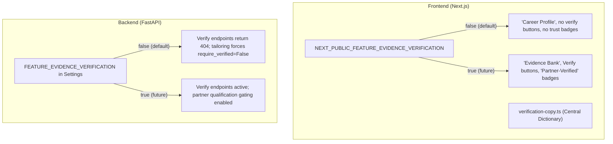

# Hidden Feature Specification: Evidence Verification & Trust Tiers

> **Status:** DORMANT (Feature-flagged OFF)  
> **Search Marker:** `[HIDDEN:EVIDENCE_VERIFICATION]`  
> **Date Hidden:** October 2026  
> **Primary Re-activation Switches:**
> - Frontend: `NEXT_PUBLIC_FEATURE_EVIDENCE_VERIFICATION="true"`
> - Backend: `FEATURE_EVIDENCE_VERIFICATION=true`

---

## 1. Executive Summary & Purpose

The RemoteJobs Public Platform initially included an in-house candidate self-verification and partner-verification concept ("Evidence Bank", "Verify All Evidence", "Partner-Verified", "Partially Verified", "% Verified" badges).

**Why it is hidden:**  
A prospective update is planned to integrate with an established, accredited third-party verification software/business that possesses proven, legally valid methods to independently verify candidate CV bullet points, credentials, and achievements.

To preserve user trust and avoid claiming or implying self-asserted "verification" ahead of this integration:
1. **The verification UI layer is hidden** (Verify buttons, verified checkmarks, trust tiers, % verified counters).
2. **The concept is rebranded neutrally** from "Evidence Bank" / "Verified Evidence" to **"Career Profile"** / **"Profile Records"** in all public-facing and onboarding views.
3. **Nothing has been deleted.** The database schema (`is_verified`, `verification_status`), Alembic migrations, entity resolution algorithms, and frontend code paths remain completely intact. When the partner integration is finalized, toggling the flags instantly reactivates the complete verification flow.

---

## 2. Architecture & Flags



### Feature Flags

| Layer | Environment Variable / Setting | Default | Purpose |
|---|---|---|---|
| **Frontend** | `NEXT_PUBLIC_FEATURE_EVIDENCE_VERIFICATION` | `false` | When `false`, suppresses verification buttons, verified badges, and loads neutral "Career Profile" copy from `verification-copy.ts`. |
| **Backend** | `FEATURE_EVIDENCE_VERIFICATION` | `False` | When `False`, gates `/api/v1/profile/evidence/verify` and `/api/v1/profile/evidence/verify-all` to return HTTP 404, forces `require_verified=False` on CV tailoring, and neutralizes cover letter heuristic copy. |

---

## 3. Quick Reactivation Checklist

To reactivate the verification system and partner trust tier:

1. **Backend Configuration (`backend/.env`):**
   ```env
   FEATURE_EVIDENCE_VERIFICATION=true
   ```
2. **Frontend Configuration (`frontend/.env.local` or environment):**
   ```env
   NEXT_PUBLIC_FEATURE_EVIDENCE_VERIFICATION=true
   ```
3. **Rebuild Frontend:**
   ```bash
   cd frontend
   npm run build
   ```
4. **Audit Codebase:**
   Search for all references to the hidden marker:
   ```bash
   git grep "HIDDEN:EVIDENCE_VERIFICATION"
   ```

---

## 4. Comprehensive Registry of Hidden Traces

### A. Frontend Functional Components & Pages

| File | Component / Section | What Was Hidden / Modified | Reactivation Behavior |
|---|---|---|---|
| `frontend/src/lib/features.ts` | Global features map | Master client-side feature flag | Set `NEXT_PUBLIC_FEATURE_EVIDENCE_VERIFICATION="true"` |
| `frontend/src/lib/verification-copy.ts` | Central copy dictionary | Dual text mappings (original vs neutral) for all public strings | Automatically switches all strings when flag is toggled |
| `frontend/src/app/profile/page.tsx` | Header actions | `Verify All Evidence` button and `% Verified (x/y)` badge | Wrapped in `FEATURES.evidenceVerification &&` |
| `frontend/src/app/profile/page.tsx` | Experience bullets list | `Partner-Verified` / `Standard` badges and `Verify / Verified ✓` button | Wrapped in `FEATURES.evidenceVerification &&` |
| `frontend/src/app/profile/page.tsx` | Skills tab | Skill item `✓ / Verify` toggle button | Wrapped in `FEATURES.evidenceVerification &&` |
| `frontend/src/app/profile/page.tsx` | Projects, Education, Certs | `Verified` badge on cards | Wrapped in `FEATURES.evidenceVerification &&` |
| `frontend/src/components/profile/profile-dialogs.tsx` | Add Bullet, Skill, Project, Education, Certification | Omitted automatic `is_verified: true` default on new manual entries | With flag off, entries are saved unverified so future partner can audit |
| `frontend/src/components/jobs/tailor-cv-modal.tsx` | Generated document result | `Partner-Verified ✓`, `Partially Verified`, and `Standard Export` badges | Wrapped in `FEATURES.evidenceVerification &&` |
| `frontend/src/components/layout/pipeline-schedule-dialog.tsx` | Automated batch checklist | `unverified-evidence` action item ("Verify items to qualify for Partner-Verified tier") | Only pushed to recommendations if `FEATURES.evidenceVerification` is `true` |
| `frontend/src/components/layout/navbar.tsx` | Navigation Items | `Evidence Bank` / `Evidence` | Uses `vcopy("bank.name")` -> `"Career Profile"` / `"Profile"` |
| `frontend/src/components/layout/footer.tsx` | Footer navigation & guarantee | `Evidence Bank` link & "derived from verified experience IDs" | Uses `vcopy` -> `"Career Profile"` & "source career IDs" |
| `frontend/src/app/onboarding/page.tsx` | Wizard Step 3 & Footer | `Evidence Bank` step label, `Verified Ingestion`, watermark | Uses `vcopy` -> `"Career Profile"`, `"Profile Ingestion"`, etc. |
| `frontend/src/components/onboarding/evidence-step.tsx` | Ingestion Step | "verifiable records in your Evidence Bank", "verified entities" | Uses `vcopy` -> "structured records in your Career Profile" |
| `frontend/src/components/onboarding/evidence-bank-step.tsx` | Step 3 Card & Stats | "Verified Achievements", "Verified Records Ingested" | Uses `vcopy` -> "Captured Achievements", "Captured Records Ingested" |
| `frontend/src/app/cv-upload/page.tsx` | CV Upload Page | "Candidate Evidence Bank", "Review Evidence Bank" | Uses `vcopy` -> `"Career Profile"`, `"Review Career Profile"` |
| `frontend/src/components/jobs/cover-letter-drawer.tsx` | Cover Letter Drawer | "grounded in verified Evidence Bank facts", "Grounded Evidence IDs" | Uses `vcopy` -> "grounded in your Career Profile facts", "Referenced Record IDs" |
| `frontend/src/components/home/architecture-dialog.tsx` | Architecture Pillars | "1. Canonical Evidence Bank", "permanent verification IDs", "Verified Bullets" | Uses `vcopy` -> "1. Canonical Career Profile", "permanent record IDs", etc. |
| `frontend/src/components/home/core-concept-animation.tsx` | Hero Animation | "3 Verified Roles", "Verified Evidence Bank", tags | Uses `vcopy` -> "3 Career Roles", "Career Profile Records", "Structured" tags |
| `frontend/src/components/home/deconstruction-visual.tsx` | Deconstruction Visual | "4 Verified Builds", "verifiable building blocks" | Uses `vcopy` -> "4 Tracked Builds", "structured building blocks" |
| `frontend/src/components/home/pipeline-timeline.tsx` | Pipeline Steps | "verified, reusable data points", "[EXP_001] Verified" badges | Uses `vcopy` -> "reusable, structured data points", "[EXP_001] Sourced" badges |
| `frontend/src/components/home/core-guarantee-banner.tsx` | Guarantee Pill | "Verified Set Inclusion" | Uses `vcopy` -> "Strict Set Inclusion" |
| `frontend/src/app/ethics/page.tsx` | AI Ethics compliance | "constructed solely from verified evidence" | Uses `vcopy` -> "constructed solely from career history and records" |
| `frontend/src/app/privacy/page.tsx` | GDPR Privacy notice | "structure your verified experience" | Uses `vcopy` -> "structure your experience" |

---

### B. Backend API & Services

| File | Endpoint / Method | Current Behavior (Flag OFF) | Reactivation Behavior (Flag ON) |
|---|---|---|---|
| `backend/app/config.py` | `Settings.FEATURE_EVIDENCE_VERIFICATION` | Defaults to `False` | Set `FEATURE_EVIDENCE_VERIFICATION=true` in `.env` |
| `backend/app/routers/profile.py` | `POST /api/v1/profile/evidence/verify` | Returns **HTTP 404** (hidden from OpenAPI docs) | Active: toggles `is_verified` on specific items |
| `backend/app/routers/profile.py` | `POST /api/v1/profile/evidence/{cat}/verify` | Returns **HTTP 404** (hidden from OpenAPI docs) | Active: toggles `is_verified` on specific items |
| `backend/app/routers/profile.py` | `POST /api/v1/profile/evidence/verify-all` | Returns **HTTP 404** (hidden from OpenAPI docs) | Active: bulk marks all user items as verified |
| `backend/app/routers/tailoring.py` | `POST /api/v1/jobs/{id}/tailor-cv` | Forces `require_verified=False` | Allows `require_verified=True` for partner exports |
| `backend/app/integrations/llm_ai_service.py` | `generate_cover_letter` (heuristic fallback) | Uses neutral lead: "Here are highlights from my engineering track record..." | Uses "Here are verified highlights from my engineering track record..." |

---

## 5. Preserved Core Architecture (Never Affected)

The **anti-hallucination engine** and **mathematical set inclusion proof** remain 100% operational:
- Discrete items are assigned permanent stable IDs (`EXP_001`, `SKILL_001`, `PROJ_001`).
- The AI Gateway selects **only IDs from the user's profile** (`selected_ids ⊆ allowed_ids`).
- The backend resolves text strictly by looking up the stable IDs in the database.
- Documents are rendered using static docx templates with zero generative drift.

This system guarantees zero hallucination **regardless** of whether items are externally verified or not.

---

## 6. Future Integration Points for Verification Partners

When integrating with an external verification partner:

1. **Webhook Ingestion:**
   Create an endpoint (e.g. `/api/v1/integrations/verifier/webhook`) that receives verification confirmation from the partner software for a given candidate or record UUID.
2. **Database Mutation:**
   Set `is_verified = True` on the target `EvidenceItem`, `Skill`, or `ExperienceRecord`.
3. **Audit Trail:**
   Store partner verification reference IDs or digital signatures in a dedicated verification audit table.
4. **Trust Tier Qualification:**
   Once items are verified by the partner, `compute_evidence_verification_status` automatically promotes documents to `"verified"` status (Partner-Verified tier).
